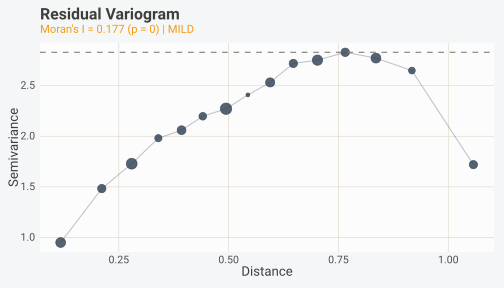
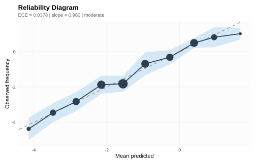
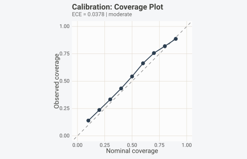
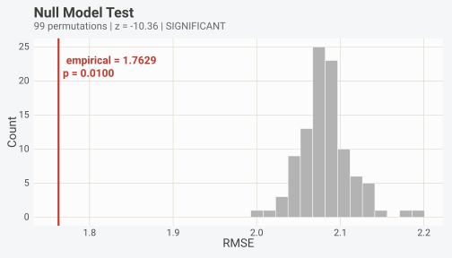
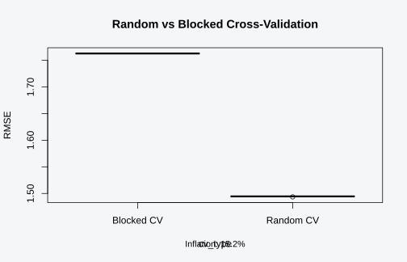
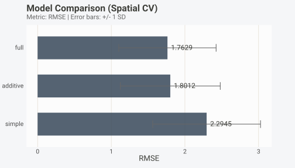
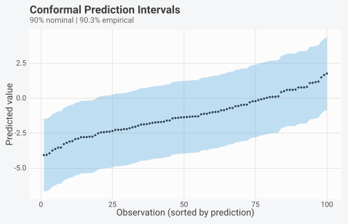
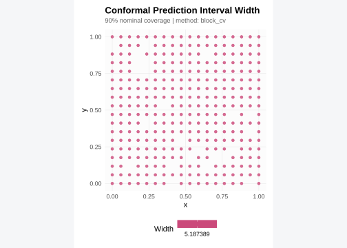
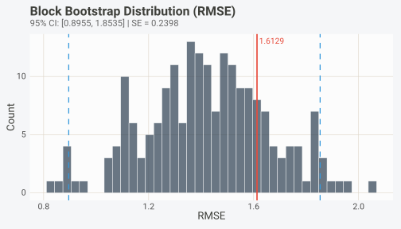
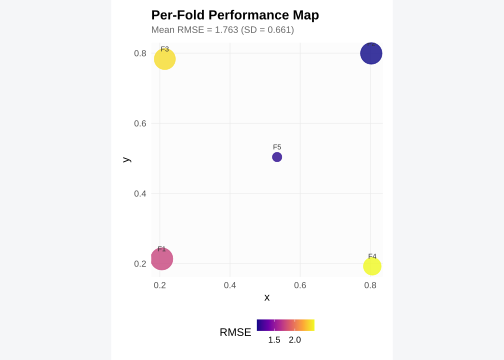

# Post-Fit Diagnostics

## Installation

``` r

install.packages("pak")           # development version
pak::pak("gcol33/BORG")
```

## Setup: simulating spatial data and fitting a model

Before running any diagnostics, we need a dataset with known spatial
structure and a fitted model we can interrogate. The
[`borg_simulate()`](https://gillescolling.com/BORG/reference/borg_simulate.md)
function generates synthetic datasets with controlled dependencies,
which makes it possible to know in advance how much metric inflation to
expect. Throughout this vignette we use a spatial simulation with
moderate autocorrelation and moderate signal strength. The simulation
places 300 observations on a spatial grid, generates five autocorrelated
predictors, and constructs a response that depends linearly on those
predictors plus spatially correlated noise.

``` r

sim <- borg_simulate(
  n    = 300,
  type = "spatial",
  n_predictors    = 5,
  signal_strength = 0.3,
  autocorrelation = 0.5,
  seed = 42
)

d <- sim$data
str(d)
#> 'data.frame':    300 obs. of  8 variables:
#>  $ x  : num  0.7059 0.8235 0.4706 0.0588 0.6471 ...
#>  $ y  : num  0.118 1 0.471 0.235 0.706 ...
#>  $ x1 : num  -1.068 0.373 -0.381 0.362 -0.278 ...
#>  $ x2 : num  0.224 3.236 1.289 -0.915 0.798 ...
#>  $ x3 : num  -0.663 -0.353 0.52 -0.799 -1.797 ...
#>  $ x4 : num  -0.529 -0.278 -0.817 -0.747 0.141 ...
#>  $ x5 : num  -0.0583 -0.9651 -0.0278 -0.3498 -0.3837 ...
#>  $ y.1: num  3.895 -3.378 -3.591 0.969 -1.999 ...
```

Because the coordinate columns are named `x` and `y` and the response
variable is also named `y`, the resulting data frame renames the
response to `y.1`. This is a deliberate design choice in
[`borg_simulate()`](https://gillescolling.com/BORG/reference/borg_simulate.md)
to avoid column name collisions. We fit a linear model using only the
five predictors, then generate blocked cross-validation folds that
respect the spatial dependency structure. These folds will be reused
across most of the diagnostics that follow.

``` r

model <- lm(y.1 ~ x1 + x2 + x3 + x4 + x5, data = d)

# Blocked spatial CV folds
cv <- borg_cv(d, coords = c("x", "y"), target = "y.1", v = 5)
```

The true R-squared for this simulation is 0.3. Any metric estimate that
substantially exceeds this value is evidence of inflation caused by
leakage through the cross-validation scheme.

## Quick diagnostic check

The fastest way to audit a dataset for leakage risks is
[`borg_check()`](https://gillescolling.com/BORG/reference/borg_check.md).
This single function runs the full BORG pipeline internally: it
diagnoses dependency structure, generates blocked CV folds, validates
the split, and optionally inspects a fitted model. The result is a tidy
data frame where each row represents one detected risk, with columns for
the risk type, severity level, a plain-language description, the number
of affected observations, and the source object that triggered the
detection.

``` r

chk <- borg_check(d, target = "y.1", coords = c("x", "y"))
chk
#> BORG Quick Check
#>   Dependency: spatial | Severity: moderate
#>   Recommended CV: spatial_block
#>   No risks detected.
```

The severity column classifies each risk into one of three categories:
`"hard_inflation"` indicates a problem that will inflate metrics
substantially, such as test observations appearing in the training set
or a feature that directly encodes the response. `"soft_inflation"`
flags a subtler issue like spatial autocorrelation that leaks through
random CV folds but may not cause dramatic inflation in every case.
`"info"` marks observations that the system flagged for awareness but
that do not necessarily compromise evaluation.

Zero rows means all tests passed. No guarantee of zero leakage, but the
check covers everything BORG can detect: spatial and temporal
autocorrelation, clustered observations, index overlap between train and
test sets, target leakage via proxy features, and preprocessing leakage
from shared normalisation statistics.

You can also pass a fitted model to
[`borg_check()`](https://gillescolling.com/BORG/reference/borg_check.md)
to run model-level inspections in the same call. This checks whether the
model object carries preprocessing artefacts or formula terms that
reference the target through a proxy variable.

``` r

chk_model <- borg_check(d, model = model, target = "y.1", coords = c("x", "y"))
chk_model
#> BORG Quick Check
#>   Dependency: spatial | Severity: moderate
#>   Recommended CV: spatial_block
#>   No risks detected.
```

The attributes of the returned object contain the full diagnosis, the
generated CV folds, and the raw risk list. You can extract these for
more detailed inspection if the summary table raises questions.

``` r

# Access the underlying BorgDiagnosis
diag <- attr(chk, "diagnosis")
diag@dependency_type
#> [1] "spatial"
diag@severity
#> [1] "moderate"
diag@recommended_cv
#> [1] "spatial_block"
```

For non-stopping diagnostics on a model object alone (without running
the full pipeline), use
[`borg_inspect()`](https://gillescolling.com/BORG/reference/borg_inspect.md).
Unlike [`borg()`](https://gillescolling.com/BORG/reference/borg.md),
which throws errors on hard violations,
[`borg_inspect()`](https://gillescolling.com/BORG/reference/borg_inspect.md)
returns a `BorgRisk` object that you can examine at your own pace
without interrupting a script.

## Residual diagnostics

A model might pass all pre-fit leakage checks and still produce biased
predictions if it fails to capture the spatial process in the data.
[`borg_check_residuals()`](https://gillescolling.com/BORG/reference/borg_check_residuals.md)
tests whether the residuals from a fitted model retain spatial
autocorrelation. If they do, the model has left spatial signal on the
table, and predictions at new locations will be systematically biased
toward the values of their neighbours in the training set.

The function accepts either a fitted model object (anything with a
[`residuals()`](https://rdrr.io/r/stats/residuals.html) method) or a raw
numeric vector of residuals. When given a model, it extracts residuals
automatically. It then computes Moran’s I on those residuals using an
inverse-distance weight matrix derived from the spatial coordinates. The
p-value comes from a randomization test that permutes the residuals
across locations.

``` r

res_check <- borg_check_residuals(model, d, coords = c("x", "y"))
res_check
#> BORG Residual Autocorrelation Check
#>   Moran's I: 0.1768 (p = 0)
#>   Assessment: MILD
#>   WARNING: Residuals have significant spatial autocorrelation.
#>   The model has not fully captured the spatial process.
```

Three quantities are reported. First, Moran’s I itself: a value near
zero indicates no spatial pattern in the residuals, positive values
indicate clustering of similar residuals, and negative values (rare in
practice) indicate spatial repulsion. Second, the p-value from the
randomization test. Third, an overall assessment that translates the
test result into a plain-language verdict: `"clean"` means the residuals
show no statistically significant spatial structure, `"mild"` means
Moran’s I is significant but below 0.3, and `"strong"` means Moran’s I
exceeds 0.3, indicating that the model is missing a spatial effect of
practical importance.

The 0.3 threshold is conservative. Even a Moran’s I of 0.15 can bias
predictions in interpolation-heavy workflows, so the threshold exists to
avoid alarm fatigue when the residual signal is too weak to act on, not
to certify that the spatial structure is absent or harmless.

The `autoplot()` method for the residual check object produces a
variogram plot. A variogram shows semivariance (half the mean squared
difference between residual values) as a function of the distance
between observation pairs. If the model has fully captured the spatial
process, the variogram should be flat: the semivariance should not
increase with lag distance. A variogram that rises steeply from the
origin and then levels off at a sill indicates residual spatial
structure with a characteristic range.

``` r

autoplot(res_check)
```



The dashed horizontal line marks the sill (maximum semivariance). Point
sizes encode the number of pairs at each distance bin, so you can judge
how much data supports each point on the curve. Thin bins at long lags
are noisy and should not drive interpretation.

When the assessment is `"mild"` or `"strong"`, adding spatial covariates
(coordinates, distance to features, a spatial smooth) to the model
formula is usually the first corrective step. After refitting, run
[`borg_check_residuals()`](https://gillescolling.com/BORG/reference/borg_check_residuals.md)
again to confirm the spatial signal has been absorbed.

## Calibration

Performance metrics like RMSE and R-squared tell you how accurate a
model is on average, but they say nothing about whether the model’s
uncertainty estimates are trustworthy. A model might report narrow
prediction intervals that are right on average but wrong for specific
subsets of the input space. Calibration diagnostics answer the question:
when the model says it is 80% confident, is it actually correct 80% of
the time?

[`borg_calibration()`](https://gillescolling.com/BORG/reference/borg_calibration.md)
supports both classification and regression problems. For
classification, it bins predicted probabilities and compares each bin’s
mean predicted probability against the observed event frequency. For
regression, it checks whether the residual distribution matches the
assumed noise model by computing observed coverage at multiple nominal
levels.

``` r

preds <- predict(model, newdata = d)
cal <- borg_calibration(preds, d$y.1, type = "regression", n_bins = 10)
cal
#> BORG Calibration Diagnostics
#> ============================
#> 
#>   Type: regression
#>   N: 300 | Bins: 10
#>   Expected Calibration Error (ECE): 0.0378
#>   Maximum Calibration Error (MCE): 0.0633
#>   Calibration MSE: 2.1922
#>   Reliability slope: 0.980 (ideal: 1.000)
#>   Reliability intercept: -0.026 (ideal: 0.000)
#>   Assessment: moderate
```

Several metrics appear in the result. The Expected Calibration Error
(ECE) is the weighted average of the absolute difference between
predicted and observed frequencies across bins. The Maximum Calibration
Error (MCE) captures the worst-case bin. The reliability slope and
intercept come from a weighted regression of observed on predicted bin
values: a perfectly calibrated model has slope 1 and intercept 0. A
slope below 1 means the model is overconfident (its predictions are too
spread out), while a slope above 1 means the model is underconfident.

Visualize these metrics with `autoplot()`.

``` r

autoplot(cal, type = "reliability")
```



The diagonal dashed line represents perfect calibration. Points above
the line indicate the model underestimates the true values in that bin;
points below indicate overestimation. Point sizes reflect the number of
observations per bin, and the shaded ribbon shows approximate confidence
intervals.

For regression models,
[`borg_calibration()`](https://gillescolling.com/BORG/reference/borg_calibration.md)
also computes a coverage curve. This shows, for each nominal coverage
level (10%, 20%, …, 90%), how many observations actually fall within the
corresponding prediction interval.

``` r

autoplot(cal, type = "coverage")
```



Coverage curves that track the diagonal closely indicate well-calibrated
estimates. Curves consistently below the diagonal indicate
overconfidence: the model’s intervals are too narrow and miss more
observations than they should.

Binning matters.
[`borg_calibration()`](https://gillescolling.com/BORG/reference/borg_calibration.md)
offers three options via the `strategy` argument. `"uniform"` creates
equal-width bins across the prediction range, which works well when
predictions are roughly uniformly distributed. `"quantile"` creates
equal-count bins, ensuring each bin has enough observations for a
reliable estimate. `"spatial"` uses k-means on the coordinates to define
bins, preventing calibration curves from being inflated by spatial
autocorrelation among predictions within the same spatial neighbourhood.

``` r

# Spatial-aware binning
coord_mat <- d[, c("x", "y")]
cal_spatial <- borg_calibration(
  preds, d$y.1,
  type = "regression",
  n_bins = 8,
  coords = coord_mat,
  strategy = "spatial"
)
cat("ECE (uniform):", round(cal$ece, 4), "\n")
#> ECE (uniform): 0.0378
cat("ECE (spatial):", round(cal_spatial$ece, 4), "\n")
#> ECE (spatial): 0.0378
```

When the spatial ECE substantially exceeds the uniform ECE, the
calibration curve was being flattered by autocorrelation: nearby
predictions are similar, so same-bin groupings artificially reduce the
apparent calibration error.

## Null hypothesis testing

A low RMSE or high R-squared does not, by itself, prove that the model
has learned a real signal. If the predictors happen to be spatially
structured and the response is also spatially structured, blocked CV can
still produce decent-looking metrics even when the predictors carry no
information about the response. This is especially common in ecology and
environmental science, where “everything is correlated with everything”
through shared spatial gradients.

[`borg_null_test()`](https://gillescolling.com/BORG/reference/borg_null_test.md)
constructs a null distribution by permuting the response variable and
re-evaluating the model under the same blocked CV scheme. Each
permutation breaks the link between predictors and response while
preserving the spatial structure of the predictors. Should the empirical
metric fall far into the tail of the null distribution, the signal is
real; if it sits near the centre, the model’s apparent performance could
be explained by spatial confounding alone.

``` r

nt <- borg_null_test(
  data    = d,
  folds   = cv,
  formula = y.1 ~ x1 + x2 + x3 + x4 + x5,
  metric  = "rmse",
  n_null  = 99,
  seed    = 42
)
nt
#> BORG Null Model Significance Test
#>   Empirical RMSE: 1.7629
#>   Null mean: 2.0815 (SD 0.0308)
#>   Z-score: -10.36
#>   P-value: 0.0100 (99 permutations)
#>   Significant: YES
```

Reported values include the empirical metric, the null distribution’s
mean and standard deviation, a z-score, and a one-sided p-value. The
p-value is computed as the proportion of null permutations that produce
a metric as extreme as (or more extreme than) the observed metric, with
a finite-sample correction that adds one to both numerator and
denominator.

A significant result (p \< 0.05) means the model performs better than
random expectation given the CV scheme. A non-significant result does
not necessarily mean the predictors are useless; it may mean the sample
size is too small or the blocked CV is too aggressive for the effect
size. In that case, the power analysis section below will help you
determine whether the experiment was adequately powered.

`autoplot()` produces a histogram of the null distribution with the
empirical value marked as a vertical red line.

``` r

autoplot(nt)
```



A useful convention is to report the null test alongside the primary
metrics in any manuscript or report. Reviewers who see “R-squared =
0.35, permutation p = 0.01 (99 permutations)” immediately know the
signal survived a spatial confounding check. The number of permutations
controls the resolution of the p-value: 99 permutations give a minimum p
of 0.01, 999 give 0.001. For publication, 999 permutations is standard.

Be aware that the null test assumes the model-fitting function is
deterministic (or at least produces stable results across permutations).
For stochastic algorithms like random forests, set the seed inside
`fit_fun` or use a wrapper that fixes internal randomness. Otherwise the
null distribution will mix model variance with permutation variance,
inflating the apparent significance.

## Model comparison

Once you know the signal is real, the next question is which model
captures it best. BORG provides two functions for model comparison:
[`borg_compare_cv()`](https://gillescolling.com/BORG/reference/borg_compare_cv.md),
which compares random versus blocked cross-validation to quantify metric
inflation, and
[`borg_compare_models()`](https://gillescolling.com/BORG/reference/borg_compare_models.md),
which evaluates multiple models under the same blocked CV folds for fair
side-by-side ranking.

### Quantifying inflation with `borg_compare_cv()`

[`borg_compare_cv()`](https://gillescolling.com/BORG/reference/borg_compare_cv.md)
runs both random and blocked cross-validation on the same data and
model, repeating each scheme multiple times for stable estimates. It
then computes the inflation: the percentage by which random CV
underestimates the error (for error metrics like RMSE) or overestimates
the performance (for metrics like R-squared). A paired t-test assesses
whether the difference is statistically significant.

``` r

comp <- borg_compare_cv(
  data    = d,
  formula = y.1 ~ x1 + x2 + x3 + x4 + x5,
  coords  = c("x", "y"),
  metric  = "rmse",
  repeats = 10,
  seed    = 123,
  verbose = FALSE
)
comp
#> CV Comparison Results
#> =====================
#> 
#> Metric: rmse
#> Random CV:  1.4944 (SD: 0.0003)
#> Blocked CV: 1.7629 (SD: 0.0000)
#> 
#> Inflation: 15.2% deflated***
#> p-value: 3.016e-28 (paired t-test, n=10 repeats)
#> 
#> Random CV significantly deflates rmse estimates.
```

The inflation estimate tells you how much your reported metrics would
change if you switched from random to blocked CV. Put concretely, an
inflation of 15% on RMSE means random CV underestimates the true
prediction error by 15%, which is more than enough to mislead model
selection decisions, overstate the model’s value in a manuscript, and
give reviewers a false sense of how well the predictions will generalise
to new spatial locations outside the training domain.

The base R [`plot()`](https://rdrr.io/r/graphics/plot.default.html)
method offers three views of the comparison.

``` r

plot(comp, type = "boxplot")
```



The boxplot shows the distribution of metric values across repeats for
each CV scheme. Non-overlapping boxes indicate inflation that is both
statistically significant and practically meaningful. The density view
(`type = "density"`) overlays the two distributions for a more direct
visual comparison, and the paired view (`type = "paired"`) shows each
repeat as a point in random-vs-blocked space, with perfect agreement on
the diagonal.

### Ranking models with `borg_compare_models()`

When you have several candidate models,
[`borg_compare_models()`](https://gillescolling.com/BORG/reference/borg_compare_models.md)
evaluates all of them using the same blocked CV folds. This ensures
differences in metrics reflect genuine predictive differences rather
than variation in fold assignments.

``` r

model_list <- list(
  simple   = y.1 ~ x1,
  additive = y.1 ~ x1 + x2 + x3,
  full     = y.1 ~ x1 + x2 + x3 + x4 + x5
)

ranking <- borg_compare_models(d, cv, models = model_list, metric = "rmse")
ranking
#> BORG Model Comparison
#>   Metric: RMSE
#> 
#>     model metric     mean        sd       min      max rank
#>      full   rmse 1.762928 0.6605704 1.0795241 2.473239    1
#>  additive   rmse 1.801200 0.6784996 0.9112583 2.564664    2
#>    simple   rmse 2.294466 0.7318924 1.5111315 3.435034    3
```

The result is a data frame sorted by mean metric value (ascending for
error metrics, descending for performance metrics), with a rank column.
The standard deviation across folds gives a rough sense of how stable
each model’s performance is. Stability counts. A model with slightly
better mean RMSE but much higher variability across folds may not be the
safest choice.

``` r

autoplot(ranking)
```



The bar chart shows mean metric values with error bars spanning one
standard deviation. Labels on the bars give exact values. The models are
ordered by rank, so the best performer appears at the top.

You can pass pre-fitted model objects instead of formulas if your models
require non-standard fitting procedures. In that case, omit `fit_fun`
and let
[`borg_compare_models()`](https://gillescolling.com/BORG/reference/borg_compare_models.md)
call each model’s own
[`predict()`](https://rdrr.io/r/stats/predict.html) method on the test
folds.

## Conformal prediction

Classical prediction intervals assume a parametric noise distribution
(usually Gaussian) and rely on asymptotic theory. Conformal prediction
produces distribution-free intervals with finite-sample coverage
guarantees: if you request 90% intervals, at least 90% of future
observations will fall inside them, with no distributional assumptions
required. The only assumption is exchangeability.

Spatial data violates exchangeability. Nearby observations are more
similar than distant ones, so residuals computed on a random calibration
set underestimate the true prediction error at new locations.
[`borg_conformal()`](https://gillescolling.com/BORG/reference/borg_conformal.md)
fixes this by computing nonconformity scores from spatially blocked
calibration residuals. Because the calibration residuals come from
predictions on held-out spatial blocks, they reflect the model’s actual
error on genuinely separated data.

``` r

conf <- borg_conformal(
  model  = model,
  data   = d,
  target = "y.1",
  coords = c("x", "y"),
  alpha  = 0.10,       # 90% intervals
  method = "split"
)
conf
#> BORG Conformal Prediction
#>   Method: split
#>   Nominal coverage: 90%
#>   Empirical coverage: 98.0%
#>   Calibration scores: 140
#>   Interval half-width (q_hat): 4.1450
#>   Predictions: 300
#>   Mean width: 8.2899 | Median: 8.2899
```

The print method reports the nominal and empirical coverage, the number
of calibration scores, the interval half-width (the conformal quantile
q-hat), and summary statistics of the interval widths. Should the
empirical coverage fall substantially below the nominal level, the
spatial blocking was too coarse or the model’s errors are spatially
heterogeneous.

Three conformal methods are available. `"split"` divides the data into
training and calibration blocks, computes scores on the calibration
blocks, and generates intervals. It is fast but uses only part of the
data. `"block_jackknife"` refits the model leaving out each block in
turn, producing more calibration scores at the cost of repeated model
fitting. `"block_cv"` uses residuals from pre-computed blocked CV folds,
which is the most natural integration with the rest of the BORG
pipeline.

``` r

conf_cv <- borg_conformal(
  model  = model,
  data   = d,
  target = "y.1",
  coords = c("x", "y"),
  alpha  = 0.10,
  method = "block_cv",
  folds  = cv
)
conf_cv
#> BORG Conformal Prediction
#>   Method: block_cv
#>   Nominal coverage: 90%
#>   Empirical coverage: 90.3%
#>   Calibration scores: 300
#>   Interval half-width (q_hat): 2.5937
#>   Predictions: 300
#>   Mean width: 5.1874 | Median: 5.1874
```

The `autoplot()` method offers two views. The default shows prediction
intervals sorted by predicted value, which makes it easy to spot whether
interval width varies systematically with the prediction magnitude.

``` r

autoplot(conf_cv, type = "intervals")
```



When coordinates are available, the map view shows interval width at
each location, revealing whether uncertainty is spatially clustered.
Wider intervals in certain regions suggest the model has less
information there, perhaps due to sparse training data or stronger local
noise.

``` r

autoplot(conf_cv, type = "map")
```



To generate intervals for new locations, pass a `new` data frame. The
conformal quantile is calibrated on the existing data and applied to
predictions at the new points.

``` r

new_locs <- data.frame(
  x  = runif(50, 0, 1),
  y  = runif(50, 0, 1),
  x1 = rnorm(50), x2 = rnorm(50), x3 = rnorm(50),
  x4 = rnorm(50), x5 = rnorm(50)
)
pred_new <- borg_conformal(
  model  = model,
  data   = d,
  new    = new_locs,
  target = "y.1",
  coords = c("x", "y"),
  alpha  = 0.10
)
head(pred_new)
#> BORG Conformal Prediction
#>   Method: split
#>   Nominal coverage: 90%
#>   Calibration scores: 140
#>   Interval half-width (q_hat): 4.1450
#>   Predictions: 6
#>   Mean width: 8.2899 | Median: 8.2899
```

The intervals have a constant width (equal to 2 \* q-hat) because split
conformal prediction uses the same quantile for all predictions.
Adaptive intervals that widen or narrow based on local difficulty
require normalised conformal prediction or locally-weighted variants,
though BORG does not currently implement those.

## Bootstrap uncertainty

A single cross-validation run produces a point estimate of model
performance: one RMSE, one R-squared. But how precise is that estimate?
Repeating the entire experiment with new data would yield a different
number.
[`borg_bootstrap()`](https://gillescolling.com/BORG/reference/borg_bootstrap.md)
answers this by constructing confidence intervals through spatial block
bootstrap resampling.

Standard bootstrap assumes independent observations. For spatial data,
resampling individual observations produces bootstrap samples where
nearby points are duplicated together, understating the true sampling
variability. Block bootstrap instead resamples entire spatial blocks
(defined by k-means clustering on coordinates), preserving within-block
correlation while generating valid resamples of the data.

``` r

boot <- borg_bootstrap(
  model   = model,
  data    = d,
  target  = "y.1",
  coords  = c("x", "y"),
  formula = y.1 ~ x1 + x2 + x3 + x4 + x5,
  metric  = "rmse",
  n_boot  = 200,
  n_blocks = 10,
  conf_level = 0.95,
  seed    = 42
)
boot
#> BORG Block Bootstrap
#> ====================
#> 
#>   Metric: RMSE
#>   Estimate: 1.6129
#>   95% CI: [0.8955, 1.8535]
#>   SE: 0.2398 | Bias: -0.1920
#>   Bootstrap replicates: 200 (spatial_block, 10 blocks)
```

The output reports the point estimate (from leave-one-block-out CV on
the original data), the 95% confidence interval, bootstrap standard
error, and bootstrap bias. Bias quantifies the systematic difference
between the bootstrap mean and the point estimate; large bias suggests
the point estimate is optimistic or pessimistic in a consistent
direction.

``` r

autoplot(boot)
```



The histogram shows the distribution of bootstrap metric values, with
the solid red line marking the point estimate and dashed blue lines
marking the confidence interval bounds. Ideally the distribution is
symmetric and centred on the point estimate. Heavy skew or multimodality
suggests instability, often because a small number of blocks dominate
the resampling.

Block count matters. The `n_blocks` parameter controls resampling
granularity: too few blocks (\< 5) means each resample is nearly
identical to the original data, underestimating uncertainty, while too
many blocks risks splitting spatially coherent groups into fragments
that no longer preserve within-block correlation. Start with 10 blocks
for datasets of 200-500 observations and scale up for larger ones.

When you already have blocked CV folds from
[`borg_cv()`](https://gillescolling.com/BORG/reference/borg_cv.md), pass
them via the `folds` argument so the bootstrap uses the same block
structure for both the point estimate and the resampling.

## Power analysis

Switching from random to blocked cross-validation reduces the effective
sample size. Observations within the same block are not independent, so
the amount of information in 300 spatially clustered observations is
less than in 300 independent ones. This reduction is captured by the
design effect (DEFF): the ratio of the actual sample size to the
effective sample size. A DEFF of 3 means 300 observations carry as much
information as 100 independent ones.

[`borg_power()`](https://gillescolling.com/BORG/reference/borg_power.md)
computes the design effect from the dependency structure, estimates the
effective sample size, and reports how much statistical power you lose
by switching to blocked CV. It also computes the minimum detectable
effect size at your target power level (default 80%), so you know the
smallest signal your experiment can reliably detect.

``` r

pw <- borg_power(
  data   = d,
  coords = c("x", "y"),
  target = "y.1",
  alpha  = 0.05,
  power  = 0.80
)
pw
#> BORG Power Analysis
#> ====================
#> 
#> Sample size:      300 observations
#> Effective size:   275 (after blocking)
#> Design effect:    1.09
#>   Components:
#>     spatial       1.09
#> 
#> Target power:     80%
#> Alpha:            0.050
#> 
#> Min detectable effect (blocked): d = 0.338
#> Min detectable effect (random):  d = 0.323
#> Effect size ratio:               1.04x
#> 
#> Sufficient data:  YES
#> 
#> Blocking reduces effective sample size from 300 to 275 (DEFF = 1.1).
#> Minimum detectable effect: d = 0.34 (blocked) vs d = 0.32 (random).
#> Despite power loss, blocked CV (spatial_block) is required for valid inference.
```

Printed results include the actual sample size, the effective sample
size after blocking, the design effect, and the minimum detectable
effect size under both random and blocked CV. The effect size ratio
tells you how much larger a signal needs to be for blocked CV to detect
it at the same power. An effect size ratio of 1.5 means you need a 50%
stronger signal with blocked CV compared to random CV.

When you supply a specific effect size via the `effect_size` argument,
the function computes the actual power under both CV schemes for that
effect size, plus the absolute power loss from switching to blocked CV.

``` r

pw2 <- borg_power(
  data        = d,
  coords      = c("x", "y"),
  target      = "y.1",
  effect_size = 0.5
)
cat("Power (random CV):", round(pw2$power_random * 100, 1), "%\n")
#> Power (random CV): 99.1 %
cat("Power (blocked CV):", round(pw2$power_blocked * 100, 1), "%\n")
#> Power (blocked CV): 98.6 %
cat("Power loss:", round(pw2$power_loss * 100, 1), "percentage points\n")
#> Power loss: 0.6 percentage points
```

The design effect is computed differently depending on the dependency
type. For spatial data, BORG uses Moran’s I and the effective sample
size from the spatial diagnosis. For temporal data, it uses the lag-1
autocorrelation with the formula DEFF = (1 + rho) / (1 - rho). For
clustered data, it uses the intraclass correlation coefficient (ICC) and
the mean cluster size with the formula DEFF = 1 + (m - 1) \* ICC. For
mixed dependencies, the components are combined multiplicatively, which
is conservative but safe.

A common situation in ecological studies is that the dataset technically
passes all leakage checks but has a DEFF above 5, leaving insufficient
power under blocked CV to detect the expected effect. Falling back on
random CV is not the answer, because random CV gives invalid inference.
Better options: collect more data, reduce the spatial grain by
aggregating observations, or simplify the model. The `recommendation`
field in the output provides guidance tailored to the specific
diagnosis.

Plan before you collect. Power analysis is most useful at the design
stage, before data collection. Simulate plausible data with
[`borg_simulate()`](https://gillescolling.com/BORG/reference/borg_simulate.md),
run
[`borg_power()`](https://gillescolling.com/BORG/reference/borg_power.md),
and check whether the planned experiment will have sufficient power
under blocked CV. This prevents a frustrating sequence: collecting
expensive field data, discovering that blocked CV is required, then
finding out that the dataset is too small.

## Per-fold performance

Aggregated metrics like mean RMSE hide spatial variation in model
performance. A model might predict well in data-dense regions and poorly
in sparsely sampled areas, but the mean metric masks this pattern
entirely, which is why per-fold inspection matters.
[`borg_fold_performance()`](https://gillescolling.com/BORG/reference/borg_fold_performance.md)
evaluates the model on each fold separately and records the metric value
along with the spatial centroid of each fold’s test set.

``` r

fold_perf <- borg_fold_performance(
  data    = d,
  folds   = cv,
  formula = y.1 ~ x1 + x2 + x3 + x4 + x5,
  coords  = c("x", "y"),
  metric  = "rmse"
)
fold_perf
#>   fold metric    value n_train n_test centroid_x centroid_y
#> 1    1   rmse 1.758274     233     67  0.2054434  0.2133450
#> 2    2   rmse 1.079524     235     65  0.8027149  0.7990950
#> 3    3   rmse 2.373717     236     64  0.2141544  0.7830882
#> 4    4   rmse 2.473239     244     56  0.8056723  0.1922269
#> 5    5   rmse 1.129883     252     48  0.5343137  0.5036765
```

The result is a data frame with one row per fold, showing the metric
value, the training and test set sizes, and the spatial centroid of the
test set. If one fold has RMSE twice as high as the rest, that fold’s
spatial region deserves closer inspection.

``` r

autoplot(fold_perf)
```



When coordinates are available, `autoplot()` produces a spatial
performance map where each point represents a fold’s test set centroid,
coloured by metric value and sized by the number of test observations.
Fold labels help identify which region is problematic, and hovering (in
interactive contexts) shows the metric value and fold index. Without
coordinates, the fallback is a bar chart of per-fold metrics with a
dashed line at the mean.

Spatial variation in performance often points to nonstationarity: the
relationship between predictors and response changes across space, and
the model cannot capture this shift with a single set of coefficients.
If one region consistently performs poorly, consider fitting
region-specific models, adding spatial interaction terms, or including
covariates that capture the local process.

## Diagnostic workflow

The tools described above are most effective when applied in a fixed
order. This checklist summarises the recommended diagnostic workflow for
any spatial modelling project.

**Step 1: Detect and block.** Run
[`borg_check()`](https://gillescolling.com/BORG/reference/borg_check.md)
on the raw data to identify dependency structure and generate blocked
folds. If risks are detected, address them before proceeding. This takes
one line of code and should be the first thing you do after loading
data.

**Step 2: Quantify inflation.** Run
[`borg_compare_cv()`](https://gillescolling.com/BORG/reference/borg_compare_cv.md)
to measure how much random CV would inflate your metrics. If the
inflation is negligible (\< 5%), spatial blocking is still correct but
the practical consequences are small. If inflation exceeds 10%, random
CV results should not be reported.

**Step 3: Test significance.** Run
[`borg_null_test()`](https://gillescolling.com/BORG/reference/borg_null_test.md)
with the blocked CV folds to confirm the model’s performance exceeds
random expectation. A non-significant result stops the workflow: there
is no point optimizing a model that has not demonstrated a signal.

**Step 4: Check residuals.** Run
[`borg_check_residuals()`](https://gillescolling.com/BORG/reference/borg_check_residuals.md)
to verify the model has absorbed the spatial structure. If residuals
show significant autocorrelation, revise the model (add spatial terms)
and return to Step 3.

**Step 5: Assess calibration.** Run
[`borg_calibration()`](https://gillescolling.com/BORG/reference/borg_calibration.md)
with spatial-aware binning to check whether the model’s uncertainty
estimates are trustworthy. Poor calibration does not affect point
prediction accuracy but invalidates any confidence or prediction
intervals.

**Step 6: Quantify uncertainty.** Run
[`borg_bootstrap()`](https://gillescolling.com/BORG/reference/borg_bootstrap.md)
for confidence intervals on your primary metric, and
[`borg_conformal()`](https://gillescolling.com/BORG/reference/borg_conformal.md)
for prediction intervals at new locations. Report these intervals
alongside point estimates.

**Step 7: Check power.** Run
[`borg_power()`](https://gillescolling.com/BORG/reference/borg_power.md)
to assess whether the dataset has sufficient effective sample size for
the detected effect. Report the design effect and effective sample size
alongside p-values.

**Step 8: Map performance.** Run
[`borg_fold_performance()`](https://gillescolling.com/BORG/reference/borg_fold_performance.md)
to identify spatial regions where the model struggles. This step is
optional but highly informative for applied work where predictions will
be used across the full study area.

## Practical guidance

### When to run which diagnostic

Not every project needs every diagnostic. Here is a decision guide.

For manuscripts reporting spatial model results, Steps 1-3 are needed at
minimum (detect, quantify inflation, null test) plus Step 6 for
uncertainty estimates. Reviewers in ecology and remote sensing
increasingly expect spatial CV comparisons and permutation p-values as
standard evidence of valid evaluation.

Predictive models headed for deployment demand Steps 4-5 (residuals and
calibration). A deployed model that produces uncalibrated uncertainty
estimates will mislead downstream decisions, even if its point
predictions are accurate.

At the design stage, before data collection, Step 7 (power analysis)
alone may be sufficient. Simulate plausible data, check that blocked CV
would leave enough effective sample size, and adjust the sampling design
before going to the field.

### Common pitfalls

**Using too few null permutations.** With `n_null = 19`, the minimum
achievable p-value is 0.05, which means you cannot distinguish a
marginally significant result from a highly significant one or report
the fine-grained p-values that reviewers expect. Resolution matters. Use
`n_null = 99` for exploratory work and `n_null = 999` for publication,
since for linear models each permutation is cheap and the cost scales
linearly.

**Ignoring the design effect.** A dataset of 500 observations with a
design effect of 10 behaves like 50 independent observations, and
reporting standard errors computed from n = 500 overstates precision by
a factor of sqrt(10). Always report the effective sample size when using
blocked CV.

**Treating calibration as optional.** Calibration errors compound
through downstream decisions. If a species distribution model reports
90% habitat suitability at a location and the true value is 60%,
conservation resources get allocated to the wrong areas. The question is
not whether the model predicts well on average, but whether you can
trust what the model says about its own confidence at any given point.

**Over-blocking.** Aggressive blocking (many large blocks) reduces the
effective sample size and can make the model appear worse than it truly
is. Block at the scale of the dependency, not larger. BORG’s
[`borg_diagnose()`](https://gillescolling.com/BORG/reference/borg_diagnose.md)
estimates the autocorrelation range and recommends a block size, but
verify that recommendation against domain knowledge about the spatial
process driving the autocorrelation.

**Comparing models on different folds.** Always use
[`borg_compare_models()`](https://gillescolling.com/BORG/reference/borg_compare_models.md)
with a shared fold set rather than generating new folds for each model.
Different fold assignments introduce fold-level variance that confounds
the comparison, making it impossible to tell whether performance
differences come from the models or from the fold assignments.

**Reporting random CV alongside blocked CV.** This sounds transparent
but is misleading. Reporting both “R-squared = 0.65 (random CV)” and
“R-squared = 0.45 (blocked CV)”, readers fixate on the higher number.
[`borg_compare_cv()`](https://gillescolling.com/BORG/reference/borg_compare_cv.md)
is for your private understanding of the inflation magnitude; the only
metric you should report publicly is the one from the valid (blocked)
evaluation scheme.

### Integration with external frameworks

BORG’s blocked CV folds can be exported to `rsample`, `caret`, or `mlr3`
format via the `output` argument of
[`borg_cv()`](https://gillescolling.com/BORG/reference/borg_cv.md). This
means you can use BORG for diagnosis and fold generation while running
the actual model fitting in your preferred framework. The diagnostics in
this vignette work with any model that has
[`predict()`](https://rdrr.io/r/stats/predict.html) and
[`residuals()`](https://rdrr.io/r/stats/residuals.html) methods, which
covers `lm`, `glm`, `ranger`, `xgboost`, and most packages in the R
modelling ecosystem.
